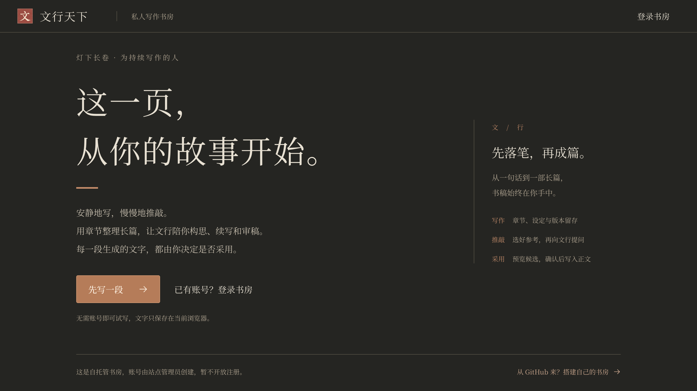
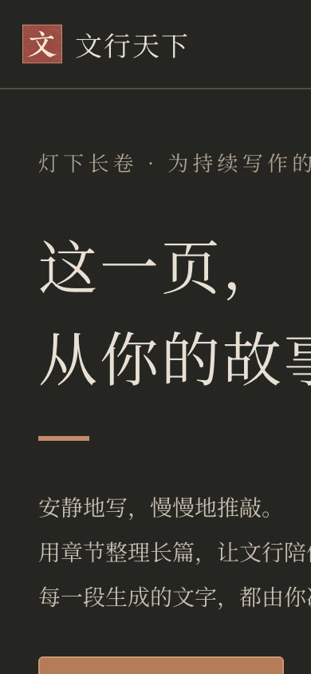

# 文行天下 · 灯下长卷

**把下一段故事，留给作者决定。**



面向中文长篇小说、网文连载与持续叙事创作的自托管写作助手。正文占据主界面，模型退到写作需要它的位置：推敲大纲、参考章节、尝试另一条情节，再由你决定哪些文字进入原稿。

暖墨色书写界面，骨白宋体正文，克制的铜色动作。没有模板商城，也不把一排模型参数放在稿件旁边。

## 第一次打开

页面从空白开始，不预置小说或演示作品。

1. **先写一段**：无需账号，直接试写或粘贴自己的片段；试写保存在当前浏览器，可导出 TXT。清除浏览器数据会移除试写。
2. **登录书房**：账号由自托管站点的管理员创建，暂不开放公众注册。登录后可保存作品、留存版本并使用模型助手。
3. **创建并开始写作**：填写作品名和第一章标题，即可进入正文。本机已有试写时，可以主动选择带入新作品；不会自动上传或覆盖其他作品。

本地试写不调用模型。浏览器无法保存或其他页面修改了同一份试写时，页面会提示保留当前文字并导出备份，避免静默覆盖。

<details>
<summary>手机上的首次使用入口</summary>



</details>

## 写作方式

- **作品与章节**：独立管理作品、设定和章节，编辑后保存，查看历史与恢复版本。
- **先看再采用**：续写与改写形成候选内容；明确采用后写入稿件，避免生成结果直接覆盖原文。
- **参考范围可见**：按对话、当前章节、全书或指定章节提供上下文。超出预算时提示调整，不静默截掉所选正文。
- **大纲先确认**：围绕大纲推演，确认方向后再生成正文。
- **分支推演**：沿历史消息继续尝试，保留之前的答案和作者选择。
- **自己的服务器**：Node.js + SQLite，账号由管理员创建，作品按账号隔离，模型密钥留在服务端。

这是需要联网调用模型的应用。稿件保存在你的服务器；被选作参考的正文会发送给你配置的模型服务商。

## 快速运行

需要 **Node.js 22.13+（22 LTS）**、npm，以及一个可用的模型 API Key。本项目使用 Node 内置 `node:sqlite`；首次运行出现 SQLite 实验性 API 提示不影响正常启动。

```bash
npm ci
cp .env.example .env
chmod 600 .env
```

编辑 `.env`，填写自己的 `TJUSAI_API_KEY`。本地 HTTP 使用 `SECURE_COOKIES=false`；生产必须使用 HTTPS 和安全 Cookie。

创建账号，密码会通过隐藏输入读取，不进入命令行参数：

```bash
python3 scripts/create-user.py --username author --name 作者
```

启动两个终端：

```bash
# 终端一：API，默认3001
node --env-file=.env server/index.mjs

# 终端二：界面，默认5173
npm run dev
```

打开 `http://localhost:5173/wenxing/`，使用刚创建的账号登录。不会自动创建默认账号，也没有公开注册入口。

生产构建与单进程启动：

```bash
npm run build
node --env-file=.env server/index.mjs
```

此时界面和 API 都由 Node 提供，默认入口 `http://localhost:3001/wenxing/`。公网部署请使用 HTTPS 反向代理，参见 [部署与回退](docs/deployment.md)。

## 模型与长上下文

默认配置为 TJUSAI 的 OpenAI 兼容接口 `https://tjusai.top/v1`，模型 `DeepSeek-V4.1-Flash`。部署者可以通过服务端环境变量更换地址和模型；兼容性以实际验证为准。

DeepSeek 官方对应模型的规格为 **1M tokens**，但当前中转的 `/models` 没有返回上下文上限。**本项目没有把“中转已实测支持百万上下文”作为已完成能力。** 默认请求预算为 262,144 tokens 的保守估算上限，实际限制受服务商与配置影响。token 不是汉字数。只有确认所配置服务商限制后才设置 `MODEL_CONTEXT_LIMIT` 与验证标记，详见 [模型配置说明](docs/models.md)。

## 数据与维护

运行数据由部署者自行保管，不属于项目源码。仓库仅提供通用配置示例；账号、稿件、密钥和备份请保存在自己的受保护存储中。通用维护方法见[自托管指南](docs/deployment.md)。

## 开发与参与

```bash
npm test
npm run build
npm run test:sites
npm audit --omit=dev
```

核心服务端测试覆盖鉴权与账号隔离、保存冲突、人工采用、历史回溯和上游错误处理。界面仍需进行真实浏览器验收；构建成功不等于视觉与交互通过。

欢迎提供带脱敏复现步骤的 Issue，或提出具体写作场景的改进。参与前阅读 [贡献指南](CONTRIBUTING.md)、[社区准则](CODE_OF_CONDUCT.md) 和 [安全说明](SECURITY.md)。如果它适合你的写作方式，可以点一个 Star，或把自托管经验分享给其他作者。

项目代码按 [MIT](LICENSE) 发布。字体与依赖保留原许可证，见 [第三方声明](THIRD_PARTY_NOTICES.md)。
